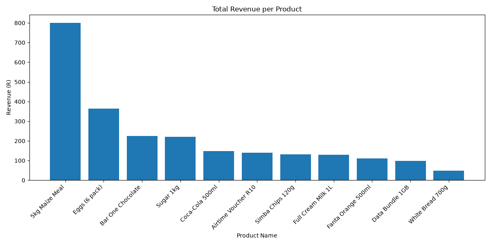
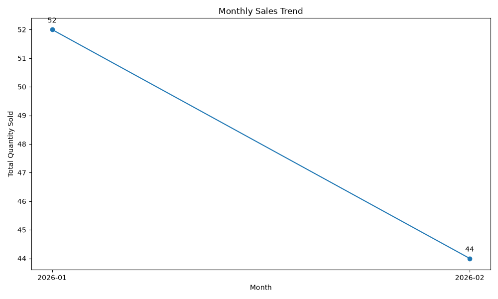

# Thabo's Corner Store — Sales Insights System

## Project overview

This project uses Python, pandas, SQLite, and matplotlib to turn Thabo's Corner Store's raw product and sales records into useful business insights. It loads and cleans the source CSV files, builds a relational database, runs SQL queries, calculates sales statistics, and generates charts.

The project started from a supplied scaffold with function signatures and TODO comments. I completed the database, analysis, visualisation, and password-access logic and tested the pipeline using `python main.py`.

## Folder structure

```text
project/
├── data/
│   ├── products.csv
│   └── sales.csv
└── Sales Insights System/
    ├── README.md
    ├── requirements.txt
    ├── main.py
    ├── data_cleaning.py
    ├── database.py
    ├── analysis.py
    ├── visualize.py
    ├── security.py
    ├── store.db
    ├── revenue_per_product.png
    └── monthly_sales_trend.png
```

**Note:** The chart file committed to Git was `monthly_sales_trend.png`. The terminal output also mentioned `monthly_trend.png`; check the folder and keep the README image link aligned with the actual committed filename.

## Before you start

1. Install Python 3.10 or later and check it with `python --version`.
2. Optionally create a virtual environment:
   ```powershell
   python -m venv venv
   .\venv\Scripts\Activate.ps1
   ```
3. Install the packages:
   ```powershell
   pip install -r requirements.txt
   ```
4. Place the provided `data` folder beside the `Sales Insights System` folder, as shown above.

## Running the program

Open a terminal inside `Sales Insights System` and run:

```powershell
python main.py
```

The program first requests a report password. Only after successful authentication does it load and clean the data, build `store.db`, print SQL and analysis results, and generate the charts. The password is not included in this README. Close the chart windows if needed to let the program finish.

## Task 2: Data cleaning findings

### Overview

In this task, I used Python and the pandas library to clean the raw product and sales data for Thabo's Corner Store. The aim was to identify and correct data-quality issues before storing the information in the SQLite database.

### Cleaning decisions

**1. Missing product information**

I removed products with missing names or unit prices because these details are needed to identify products and calculate sales revenue accurately.

**2. Inconsistent product categories**

I standardised the product categories using title case. For example, "beverages" was changed to "Beverages". This ensures that products belonging to the same category are grouped correctly.

**3. Duplicate records**

I removed duplicate records from both datasets to prevent products and sales from being counted more than once.

**4. Inconsistent date formats**

I converted sales dates into the standard YYYY-MM-DD format. For dates written with slashes or hyphens, I used the day-month-year interpretation to keep the dates consistent.

**5. Missing or invalid sales dates**

I removed sales records with missing or invalid dates because they cannot be reliably included in daily or monthly sales trend analysis.

**6. Missing quantities**

I removed transactions with missing quantities because I could not determine how many units were sold without making assumptions.

**7. Missing payment methods**

I replaced missing payment methods with "Unknown" rather than guessing whether customers paid using cash, card or mobile money.

**8. Invalid product references**

I removed sales records referencing product IDs that did not exist in the cleaned products dataset. This helps maintain consistency between the sales and products tables.

### Data cleaning results

| Dataset | Original records | Removed | Clean records |
|---|---:|---:|---:|
| Products | 16 | 4 | 12 |
| Sales | 71 | 28 | 43 |

### Conclusion

After cleaning the datasets, I was left with 12 product records and 43 sales records. I kept the original CSV files unchanged. My earlier cleaning notes also refer to `cleaned_products.csv` and `cleaned_sales.csv`; check that those files exist before claiming them as submitted evidence.

This process helped me understand why data cleaning is important before performing analysis. The cleaned datasets are then stored in an SQLite database.

## Task 3: Relational database and SQL queries

I used SQLite to store the cleaned information in two related tables. The `products` table uses `product_id` as its primary key. The `sales` table uses `sale_id` as its primary key and references `products.product_id` as a foreign key. Enabling foreign keys helps prevent sales from referring to missing products.

I used SQL JOINs to combine the sales and products tables using `product_id`. This allowed me to access product prices alongside sales quantities and calculate revenue. I also used `SUM()`, `COUNT()`, `GROUP BY`, and `ORDER BY` to answer business questions.

### Query 1: Total revenue per product

**Business question:** Which products generate the most revenue?

```sql
SELECT p.product_name, ROUND(SUM(s.quantity * p.unit_price), 2) AS revenue
FROM sales AS s JOIN products AS p ON s.product_id = p.product_id
GROUP BY p.product_id, p.product_name
ORDER BY revenue DESC, p.product_name;
```

**Actual output from `python main.py`:**

| Product | Revenue (R) |
|---|---:|
| 5kg Maize Meal | 801.00 |
| Eggs (6 pack) | 364.00 |
| Bar One Chocolate | 224.00 |
| Sugar 1kg | 220.50 |
| Coca-Cola 500ml | 148.00 |
| Airtime Voucher R10 | 140.00 |
| Simba Chips 120g | 132.00 |
| Full Cream Milk 1L | 129.00 |
| Fanta Orange 500ml | 111.00 |
| Data Bundle 1GB | 98.00 |
| Coca-Cola 500ml | 74.00 |
| White Bread 700g | 48.00 |

The query groups by product ID as well as name, so two different product IDs can appear under the same product name. The highest-revenue product in this output is 5kg Maize Meal.

### Query 2: Best-selling product by quantity

**Business question:** Which product sells the most units?

```sql
SELECT p.product_name, SUM(s.quantity) AS units_sold
FROM sales AS s JOIN products AS p ON s.product_id = p.product_id
GROUP BY p.product_id, p.product_name
ORDER BY units_sold DESC, p.product_name
LIMIT 1;
```

**Actual result:**

| Product | Units sold |
|---|---:|
| Bar One Chocolate | 16 |

Bar One Chocolate sold the most units (16). This differs from the highest-revenue product, 5kg Maize Meal.

### Query 3: Sales by payment method

**Business question:** How many transactions use each payment method?

```sql
SELECT payment_method, COUNT(*) AS transaction_count
FROM sales
GROUP BY payment_method;
```

**Actual results:**

| Payment method | Transactions |
|---|---:|
| Card | 10 |
| Cash | 14 |
| Mobile Money | 11 |
| Unknown | 8 |

Cash was the most common recorded payment method. Eight transactions had missing payment information that was classified as `Unknown` during cleaning.

### Query 4: Revenue by product category

**Business question:** Which product categories generate the most revenue?

```sql
SELECT p.category, ROUND(SUM(s.quantity * p.unit_price), 2) AS revenue
FROM sales AS s JOIN products AS p ON s.product_id = p.product_id
GROUP BY p.category
ORDER BY revenue DESC, p.category;
```

**Actual results:**

| Product category | Revenue (R) |
|---|---:|
| Household | 1,021.50 |
| Dairy | 493.00 |
| Snacks | 356.00 |
| Beverages | 333.00 |
| Airtime & Data | 238.00 |
| Bakery | 48.00 |

Household products generated the highest revenue in the cleaned data.

### Query 5: Five highest-revenue sales days

**Business question:** Which five days generated the most sales revenue?

```sql
SELECT s.sale_date, COUNT(*) AS transactions,
       ROUND(SUM(s.quantity * p.unit_price), 2) AS revenue
FROM sales AS s JOIN products AS p ON s.product_id = p.product_id
GROUP BY s.sale_date
ORDER BY revenue DESC, s.sale_date
LIMIT 5;
```

**Actual results:**

| Date | Transactions | Revenue (R) |
|---|---:|---:|
| 2026-01-07 | 2 | 534.00 |
| 2026-01-22 | 1 | 178.00 |
| 2026-01-03 | 2 | 122.00 |
| 2026-01-12 | 1 | 98.00 |
| 2026-02-13 | 1 | 98.00 |

7 January 2026 had the highest revenue among the sales dates shown (R534 across two transactions).

### SQL query evidence

All five queries above were executed successfully using `python main.py`. The tables reproduce the actual terminal output. The first query groups by product ID, so `Coca-Cola 500ml` appears twice for two separate product IDs; this is retained exactly as returned by SQLite.

## Task 4: Sales analysis

I used Python functions, loops, conditionals, lists, and dictionaries to analyse the cleaned sales records.

| Measure | Result |
|---|---|
| Total sales records | 43 |
| Low-stock alert | Data Bundle 1GB |
| January 2026 quantity sold | 52 units |
| February 2026 quantity sold | 44 units |
| Average basket size | 2.23 units per sales record |

The total quantity sold decreased by eight units from January to February, approximately 15.4%. This is a change in units sold, not necessarily a change in revenue. The low-stock alert suggests that Thabo should check availability of the Data Bundle 1GB product.

## Task 5: Visualisations

I created two charts using matplotlib:

**Revenue per product:** A bar chart showing which products generated the most revenue. 5kg Maize Meal led the results at R801.



**Monthly sales trend:** A line chart showing quantities sold in January and February 2026.



Both charts were displayed successfully during the final run of the program.

## Task 6: Data security gate

I completed `security.py` using `hash_password()`, `check_password()`, and `login_gate()`. The password is checked using SHA-256 hashes; the original password is not stored in the source code. The comparison uses `hmac.compare_digest`, and the login gate allows a maximum of three attempts. I enabled the gate in `main.py` before the data-loading, SQL reporting, analysis, and chart-generation steps.

**Successful test:** Running `python main.py` prompted for a password. After I entered the correct password, the terminal displayed `Access granted.` and all five processing stages finished, including generating the two charts. This confirms the authorised-access path. The three-failed-attempts path should also be tested before final submission; it is not shown in the available terminal output.

**Security limitations:** This is an educational example. Unsalted SHA-256 is not recommended for storing real user passwords; production systems should use a password-specific salted hashing algorithm such as Argon2id or scrypt. The login gate protects the application workflow but does not encrypt the SQLite database or existing chart image files. Password entry should use `getpass.getpass()` rather than visible `input()` for the final version. Never publish the actual password or hash in the README.

### CIA-triad reflection (Task 6; 209 words)

**1. Confidentiality:** In my Sales Insights System, confidentiality means keeping Thabo’s business reports away from people who are not authorised to view them. I added a login gate in `security.py` and connected it to `main.py` before the data-loading and reporting stages. The program uses SHA-256 to hash the password entered by a user and compares that hash with the stored hash, rather than comparing plain-text passwords. It allows three attempts before denying access. For a real application, I would store a properly salted password hash in a protected database instead of keeping a fixed hash in the source code.

**2. Integrity:** The login gate controls access but does not ensure that the records themselves are accurate. In `database.py`, primary keys uniquely identify products and sales, while a foreign key links each sale to a product. Appropriate column types help keep quantities and prices consistent. I also cleaned the CSV files before importing them, removing invalid records that could distort the analysis.

**3. Availability:** Because the system runs on my laptop, hardware failure, theft, or accidental deletion could make the reports unavailable. I would make regular backups of the SQLite database and source files to a secure location, and test that those backups can be restored when needed.

## Task 7: Key Business Insights — Advice for Thabo

After looking at the sales records, I found a few things that could help Thabo decide what to stock and how to improve sales. The **5kg Maize Meal** brought in the most revenue at **R801**, followed by **Eggs (6 pack)** at **R364**. However, **Bar One Chocolate** was the product customers bought in the largest quantity, with **16 units sold**. This tells me that the product making the most money is not always the one selling the most units. Thabo should keep an eye on both when ordering stock.

The **Household** category brought in the most revenue, at **R1,021.50**. Cash was the most common payment method, with **14 transactions**, although **8 transactions** had no recorded payment method. I would recommend making sure the payment method is captured every time, so the reports become more useful.

The sales records show **52 units sold in January** and **44 in February 2026**. That is a drop of eight units, but two months of data are not enough to say exactly why it happened. Thabo could watch sales over the next few months and ask customers whether there are products they would like the shop to carry.

I also noticed that **Data Bundle 1GB** was flagged as low in stock. Thabo should check whether it needs to be reordered before it runs out. The average sale was **2.23 items**, so small offers on products that go well together might encourage customers to buy more. Overall, I would suggest using these reports regularly to make practical stock and sales decisions, while also checking profit rather than revenue alone.

## Final run and project status

The final terminal output ended with:

```text
[4/5] Running analysis...
Total sales records: 43
Low stock alerts: ['Data Bundle 1GB']
Monthly trend: {'2026-01': 52, '2026-02': 44}
Average basket size: 2.23

[5/5] Generating charts...
Charts saved as revenue_per_product.png and monthly_trend.png
```

## Version control

I used Git to track my changes and pushed the completed work to GitHub:

https://github.com/Sodi211/Sales-Insights-System

### Latest confirmed GitHub update

Task 6 was committed and pushed to `main` as commit `6286695` (`Complete Task 6 security gate and CIA triad reflection`). The Task 7 README update with all five query results should be committed separately. Git line-ending (LF/CRLF) warnings on Windows are informational, not errors.
